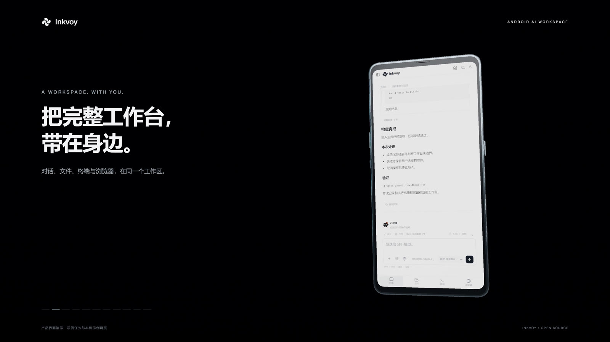

# Inkvoy

**An Android AI workspace that keeps working after the conversation ends.**

Coding, security research and reverse engineering — a terminal, project files, a controllable browser and App control, all on the phone in your hand.

 -3DDC84?logo=android&logoColor=white)  



The screenshot uses demonstration task data. Current release: **5.4.0** (versionCode 29).

## Status

| Item | State |
| --- | --- |
| Source | Complete and buildable (GPL-3.0-only). 5.4.0 lives on `main` and `release/5.4.0` |
| Installable APK | **Published as [v5.4.0](https://github.com/Wyun09/inkvoy/releases/tag/v5.4.0)**: ≈2.1 MiB lite build; ≈588 MiB offline build that bundles the offline Debian runtime |
| Physical-device acceptance | **Not done.** 244 passing framework checks are not device acceptance — see [VERIFICATION.md](VERIFICATION.md) |
| Build cost | Three commands for the JS layer; the APK additionally needs the Android SDK, JDK 17, Maven 3.9, the runtime image and your own signing key |

## Latest release: 5.4.0

Rebuilds the conversation, composer, navigation and settings visuals after the ChatGPT mobile screenshots: neutral light surfaces and charcoal dark surfaces, a circular top action row, a white rounded composer, a glass material layer for the bottom composer and a clearer reply hierarchy. Secondary composer controls now live in the "tools and modes" popover so they cannot collide with the input or the send action at narrow widths. The existing models, tools and workflows are kept, including the 5.3.1 OpenAI Responses fix. Lite and offline builds are provided; see [docs/RELEASE-5.4.0.md](docs/RELEASE-5.4.0.md).

## The gap it closes

Most phone-side AI assistants stop at advice: they print a command and you switch to a terminal to run it; they point at a page element and you tap it yourself. Inkvoy puts the execution side on the phone too —

- it **actually runs** that command in a terminal and reports stdout, stderr and exit status;
- it **actually clicks** in the browser and returns the observed nodes, coordinates and screenshots to the conversation;
- it edits **real project files** and runs **real builds**.

The cost is paid in permissions, CPU time and attack surface on that same phone, so the boundaries are documented below instead of hidden.

## Capabilities

**A continuous work record** — streaming replies, reasoning, the tool execution chain, stdout, stderr, exit status and expandable results. One task from start to finish instead of disconnected fragments.

**Terminal and files** — a bundled Debian 13 (trixie) ARM64 userland: PTY, bash 5.2.37, Python 3.13.5, Node 20.19.2, Git 2.47.3, OpenJDK 21.0.12.1, binutils 2.44 / GCC 14, plus a reverse-engineering toolchain of JADX 1.5.6, Apktool 3.0.3, smali/baksmali 2.5.2, CFR 0.152 and radare2 6.2.4 + r2ghidra. Project files are readable and writable; development processes can persist. The image holds 53,474 files and unpacks to ≈1.34 GB, so plan for ≈2 GB of free space.

**An observable browser** — observe, click, type, clear, scroll, zoom and script, with shared human/AI control and split view over the same page.

**Your own models and tools** — DeepSeek web bridge, custom OpenAI-compatible endpoints, ChatGPT account connection, MCP, plugins and skills.

**Long tasks** — `/` commands, `@` references, a context panel, compaction, plans, goals, subagents and multi-endpoint collaboration.

**App control and accessibility** — drive only the apps you **explicitly select**, with per-session consent and a pause control; reading size, contrast, TalkBack and reduced motion are supported.

> Real availability depends on the model, web state, account permissions and Android build; the verified scope is in [VERIFICATION.md](VERIFICATION.md).

## Architecture

| Layer | Location | Notes |
| --- | --- | --- |
| Android host | `app/src/main/java/io/github/deepseekbridge/` | `MainActivity` (single activity + WebView), `StudioApplication` |
| Local gateway | same package, `BridgeService` | User-started foreground service (`specialUse`), loopback API gateway, `exported="false"` |
| App control | same package, `AppControlService` | Accessibility service guarded by `BIND_ACCESSIBILITY_SERVICE` |
| Native layer | `app/src/main/cpp/` | `termux.c` (PTY / processes), `studio.c` (JNI bridge) |
| UI and engine | `js/`, `js/core/` | `engine.js`, `client.js`, `core/browser.js`, `core/protocol.js`, `mcp-worker.js`, `mobile-browser.js`, bundled into assets by esbuild |
| Runtime | `app/src/main/assets/runtime/` | Debian ARM64 image plus manifest; size and SHA-256 are verified before start |
| Tests and evidence | `test/`, `verification/` | ≈75 Node test files, 6 Java self-test groups, per-release logs |

## Permissions and security boundaries

Every item below is the price of the capabilities above, and anyone reading the code should see it up front:

| Declaration | Purpose | Boundary |
| --- | --- | --- |
| Accessibility service (`BIND_ACCESSIBILITY_SERVICE`) | Read and drive **user-selected** app UIs | Scope is limited to the apps you tick; per-session consent and the floating pause control take priority; no silent background operation |
| `MANAGE_EXTERNAL_STORAGE` | Read and write project files | Broad by nature; a documented relaxation |
| `FOREGROUND_SERVICE` / `FOREGROUND_SERVICE_SPECIAL_USE` | Keep long tasks and the local gateway alive | Foreground notification is visible and user-stoppable |
| `usesCleartextTraffic="true"` | Loopback traffic and custom endpoints | A relaxation: evaluate it before pointing Inkvoy at third-party HTTP endpoints |
| `allowBackup="false"` | App data stays out of backup export | — |

Inference does not run on the device; it goes to the endpoint you choose. The runtime, files, browser and toolchain stay local.

## Build

UI and engine (Node.js 24):

```sh
npm ci
npm run build:assets
npm test
```

An APK additionally needs the Android SDK, JDK 17, Maven 3.9, the offline runtime image and **your own signing key** — the original release key is not reproducible, and a self-signed APK cannot update an installation signed by the published key. See [docs/BUILD.md](docs/BUILD.md).

## Verification

| Check | Result | Notes |
| --- | --- | --- |
| Android framework regression | 244 passed, 0 failed/errored/skipped | API 26/33 |
| JavaScript checks | 403 passed, 0 failed/cancelled/skipped | Includes the OpenAI Responses stream regressions |
| Layout audit | 7 viewports / densities, 36 route snapshots, 0 horizontal page overflow | Deterministic test fixture |
| Final signed APK asset and script checks | 22 passed | Lite and offline builds |
| Physical-device acceptance | **Not done** | Over-install, vendor keyboard, display cutout and real GPU smoothness on Android 13 still need confirmation |

CI ([.github/workflows/checks.yml](.github/workflows/checks.yml)) covers the JavaScript checks only; the Android framework regression needs a real built APK and currently reproduces locally. Full records: [verification/regression-540.json](verification/regression-540.json).

APK SHA-256: lite `769f2f51845536b429de174167cd4d7636905ba18920a672704e7b1d1cc75906` (2,156,870 bytes); offline `dcfdf0a29a14af9e4bec9f7b43a8f49229e61d9c92cee5995480c3b64de4a39f` (616,077,718 bytes). Signing certificate SHA-256 `cc8f15b569d5e813c68d49f4fa17d19afbe6f7526ef5dbdade88e317116c2b59`.

## Versions and provenance

**Eighteen versions** (0.1.0 through 5.1.1) were recovered from release snapshots that were actually saved, each as its own restoration commit plus a `release/<version>` branch. Import dates are the real restoration dates rather than backdated development commits, and versions whose sources are missing are recorded in [docs/HISTORY.md](docs/HISTORY.md). On top of that, **5.2.0, 5.3.0, 5.3.1 and 5.4.0** are post-recovery development releases: their code lives on `main`, with the matching `release/5.2.0`, `release/5.3.0`, `release/5.3.1` and `release/5.4.0` branches.

**Naming note**: the repository and product are Inkvoy. The package id `io.github.deepseekbridge` and some file names date from the earlier DeepSeek Android Bridge period and are kept so existing installs can be updated in place.

Large artifacts: the two 5.4.0 APKs are published as assets of the [v5.4.0 release](https://github.com/Wyun09/inkvoy/releases/tag/v5.4.0); the ≈586 MiB runtime image and the full release source archives remain listed in [EXTERNAL_ARTIFACTS.json](EXTERNAL_ARTIFACTS.json) and are not in regular Git.

## Contributing

See [CONTRIBUTING.md](CONTRIBUTING.md). Questions and suggestions go through GitHub Issues; for security issues, please confirm details privately with the maintainer before publishing them.

## License

Project-owned code is **GPL-3.0-only**. Third-party components, fonts, runtimes and assets keep their own licenses and attribution — see [LICENSING.md](LICENSING.md), [THIRD_PARTY_NOTICES.md](THIRD_PARTY_NOTICES.md) and `third_party/`.
