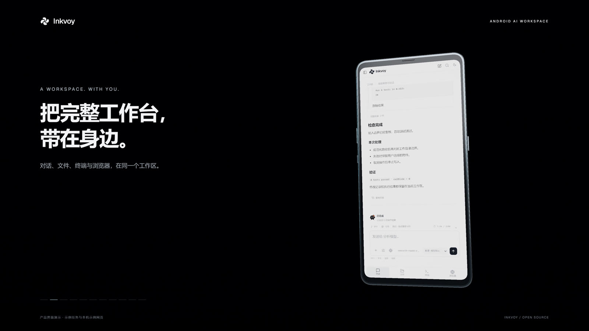

# Inkvoy

**An Android AI workspace that keeps working after the conversation ends.**

Coding, security research and reverse engineering — a terminal, project files, a controllable browser and App control, all on the phone in your hand.

 -3DDC84?logo=android&logoColor=white)  



The screenshot uses demonstration task data. Current release: **5.1.1** (versionCode 25).

## Status

| Item | State |
| --- | --- |
| Source | Complete and buildable (GPL-3.0-only) |
| Installable APK | **Not published.** The ≈588 MiB APK bundles an offline Debian runtime; it is listed in [EXTERNAL_ARTIFACTS.json](EXTERNAL_ARTIFACTS.json) and has not been uploaded as a Release asset |
| Physical-device acceptance | **Not done.** 230 passing framework checks are not device acceptance — see [VERIFICATION.md](VERIFICATION.md) |
| Build cost | Three commands for the JS layer; the APK additionally needs the Android SDK, JDK 17, Maven 3.9, the runtime image and your own signing key |

## The gap it closes

Most phone-side AI assistants stop at advice: they print a command and you switch to a terminal to run it; they point at a page element and you tap it yourself. Inkvoy puts the execution side on the phone too —

- it **actually runs** that command in a terminal and reports stdout, stderr and exit status;
- it **actually clicks** in the browser and returns the observed nodes, coordinates and screenshots to the conversation;
- it edits **real project files** and runs **real builds**.

The cost is paid in permissions, CPU time and attack surface on that same phone, so the boundaries are documented below instead of hidden.

## Capabilities

**A continuous work record** — streaming replies, reasoning, the tool execution chain, stdout, stderr, exit status and expandable results. One task from start to finish instead of disconnected fragments.

**Terminal and files** — a bundled Debian 13 (trixie) ARM64 userland: PTY, bash 5.2.37, Python 3.13.5, Node 20.19.2, Git 2.47.3, OpenJDK 21.0.12.1, binutils 2.44 / GCC 14, plus a reverse-engineering toolchain of JADX 1.5.6, Apktool 3.0.3, smali/baksmali 2.5.2, CFR 0.152 and radare2 6.2.4 + r2ghidra. Project files are readable and writable; development processes can persist. The image holds 53,474 files and unpacks to ≈1.34 GB, so plan for ≈2 GB of free space.

**An observable browser** — observe, click, type, clear, scroll, zoom and script, with shared human/AI control and split view over the same page.

**Your own models and tools** — DeepSeek web bridge, custom OpenAI-compatible endpoints, ChatGPT account connection, MCP, plugins and skills.

**Long tasks** — `/` commands, `@` references, a context panel, compaction, plans, goals, subagents and multi-endpoint collaboration.

**App control and accessibility** — drive only the apps you **explicitly select**, with per-session consent and a pause control; reading size, contrast, TalkBack and reduced motion are supported.

> Real availability depends on the model, web state, account permissions and Android build; the verified scope is in [VERIFICATION.md](VERIFICATION.md).

## Architecture

| Layer | Location | Notes |
| --- | --- | --- |
| Android host | `app/src/main/java/io/github/deepseekbridge/` | `MainActivity` (single activity + WebView), `StudioApplication` |
| Local gateway | same package, `BridgeService` | User-started foreground service (`specialUse`), loopback API gateway, `exported="false"` |
| App control | same package, `AppControlService` | Accessibility service guarded by `BIND_ACCESSIBILITY_SERVICE` |
| Native layer | `app/src/main/cpp/` | `termux.c` (PTY / processes), `studio.c` (JNI bridge) |
| UI and engine | `js/`, `js/core/` | `engine.js`, `client.js`, `core/browser.js`, `core/protocol.js`, `mcp-worker.js`, `mobile-browser.js`, bundled into assets by esbuild |
| Runtime | `app/src/main/assets/runtime/` | Debian ARM64 image plus manifest; size and SHA-256 are verified before start |
| Tests and evidence | `test/`, `verification/` | ≈75 Node tests, 6 Java self-test groups, per-release logs |

## Permissions and security boundaries

Every item below is the price of the capabilities above, and anyone reading the code should see it up front:

| Declaration | Purpose | Boundary |
| --- | --- | --- |
| Accessibility service (`BIND_ACCESSIBILITY_SERVICE`) | Read and drive **user-selected** app UIs | Scope is limited to the apps you tick; per-session consent and the floating pause control take priority; no silent background operation |
| `MANAGE_EXTERNAL_STORAGE` | Read and write project files | Broad by nature; a documented relaxation |
| `FOREGROUND_SERVICE` / `FOREGROUND_SERVICE_SPECIAL_USE` | Keep long tasks and the local gateway alive | Foreground notification is visible and user-stoppable |
| `usesCleartextTraffic="true"` | Loopback traffic and custom endpoints | A relaxation: evaluate it before pointing Inkvoy at third-party HTTP endpoints |
| `allowBackup="false"` | App data stays out of backup export | — |

Inference does not run on the device; it goes to the endpoint you choose. The runtime, files, browser and toolchain stay local.

## Build

UI and engine (Node.js 24):

```sh
npm ci
npm run build:assets
npm test
```

An APK additionally needs the Android SDK, JDK 17, Maven 3.9, the offline runtime image and **your own signing key** — the original release key is not reproducible, and a self-signed APK cannot update an installation signed by the published key. See [docs/BUILD.md](docs/BUILD.md).

## Verification

| Check | Result | Notes |
| --- | --- | --- |
| Android framework regression | 230 passed, 0 failed/errored/skipped | API 26/33, including 12 settings-navigation regressions |
| JavaScript checks | 390 checks covered | First full run 389/390; a null dereference in a wait predicate was fixed and the 5 affected checks re-ran green |
| Onboarding / startup / production-package UI | 12 passed | — |
| Physical-device acceptance | **Not done** | Vendor settings navigation still needs an over-install confirmation |

CI ([.github/workflows/checks.yml](.github/workflows/checks.yml)) covers the JavaScript checks only; the Android framework regression needs a real built APK and currently reproduces locally. Full records: [verification/regression-511.json](verification/regression-511.json).

APK SHA-256 `b7c5314db1df61bf8760c3db497bf80b7a9d18baa97be4ff6e27830ca02ed7f5`; signing certificate SHA-256 `cc8f15b569d5e813c68d49f4fa17d19afbe6f7526ef5dbdade88e317116c2b59`.

## Versions and provenance

**Eighteen versions** (0.1.0 through 5.1.1) were recovered from release snapshots that were actually saved, each as its own restoration commit plus a `release/<version>` branch. Import dates are the real restoration dates rather than backdated development commits, and versions whose sources are missing are recorded in [docs/HISTORY.md](docs/HISTORY.md).

**Naming note**: the repository and product are Inkvoy. The package id `io.github.deepseekbridge` and some file names date from the earlier DeepSeek Android Bridge period and are kept so existing installs can be updated in place.

Large artifacts (the ≈588 MiB APK, the ≈586 MiB runtime image and full release source archives) are listed in [EXTERNAL_ARTIFACTS.json](EXTERNAL_ARTIFACTS.json) and are not in regular Git.

## Contributing

See [CONTRIBUTING.md](CONTRIBUTING.md). Questions and suggestions go through GitHub Issues; for security issues, please confirm details privately with the maintainer before publishing them.

## License

Project-owned code is **GPL-3.0-only**. Third-party components, fonts, runtimes and assets keep their own licenses and attribution — see [LICENSING.md](LICENSING.md), [THIRD_PARTY_NOTICES.md](THIRD_PARTY_NOTICES.md) and `third_party/`.
