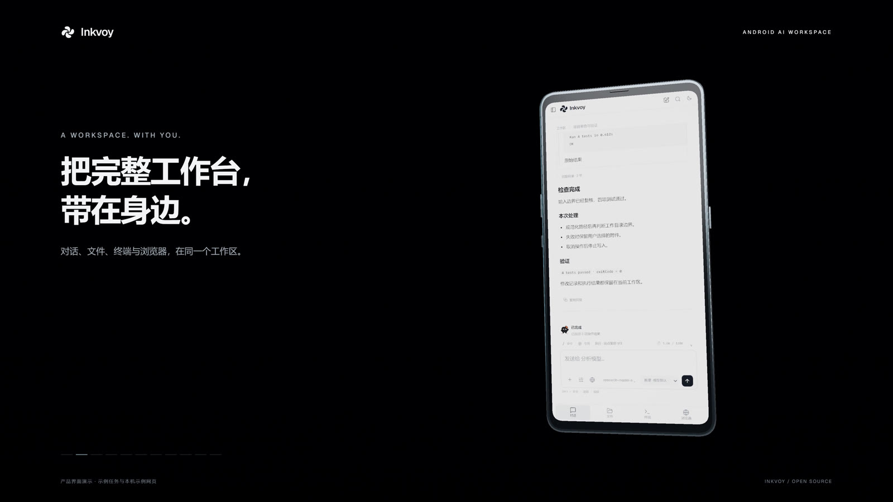

# Inkvoy

**Android 手机上的 AI 工作台：对话结束后，它继续把活干完。**

编程、安全研究、逆向分析——终端、文件、可操控的浏览器和 App 操控，全在同一台手机上。

 -3DDC84?logo=android&logoColor=white)  



界面截图使用示例任务数据。当前版本 **5.4.0**（versionCode 29）。

## 现在的状态

| 项目 | 状态 |
| --- | --- |
| 源码 | 完整开放，可自行构建（GPL-3.0-only）。5.4.0 代码在 `main` 与 `release/5.4.0` 分支 |
| 安装包 | **已发布 [v5.4.0](https://github.com/Wyun09/inkvoy/releases/tag/v5.4.0)**：轻量版约 2.1 MiB；离线完整版约 588 MiB，内含离线 Debian 运行时镜像 |
| 实体手机验收 | **未完成**。框架回归 244 项通过不等于真机验收，见 [VERIFICATION.md](VERIFICATION.md) |
| 构建成本 | JS 部分三条命令；APK 另需 Android SDK、JDK 17、Maven 3.9、离线镜像和自己的签名 |

## 最新版本：5.4.0

参考 ChatGPT 手机端截图重做应用的对话、输入区、导航和设置视觉：中性白灰浅色界面与炭黑深色界面、顶部圆形按钮组、白色圆角输入区、贴底玻璃材质输入面板与更清晰的回复层级。输入框下方的次级控件收进「工具与模式」弹层，避免在窄屏上与输入和发送互相覆盖。保留原有模型、工具与工作流，并包含 5.3.1 的 OpenAI Responses 修复。提供轻量版与离线完整版，详见 [5.4.0 说明](docs/RELEASE-5.4.0.md)。

## 它在解决什么问题

多数手机端 AI 助手停在「给你建议」：给出命令，你要切到终端自己敲；指出页面元素，你要自己点。Inkvoy 把执行端也放进了手机——

- 它在**终端里真的运行**那条命令，回填 stdout、stderr 和退出码；
- 它在**浏览器里真的点**，把观察到的节点、坐标和截图交回对话；
- 它改的是**真实项目文件**，跑的是**真的构建**。

代价是权限、算力和安全边界都由这台手机承担，所以下面把边界写清楚，而不是藏着。

## 能力

**连续的工作过程** — 流式回复、思考过程、工具执行链、标准输出、错误输出、退出状态、可展开的结果。一个任务从头看到尾，而不是一串互不相干的片段。

**终端与文件** — 随包附带 Debian 13 (trixie) ARM64 用户态：PTY、bash 5.2.37、Python 3.13.5、Node 20.19.2、Git 2.47.3、OpenJDK 21.0.12.1、binutils 2.44 / GCC 14，以及逆向工具链 JADX 1.5.6、Apktool 3.0.3、smali/baksmali 2.5.2、CFR 0.152、radare2 6.2.4 + r2ghidra。项目文件可读写，开发进程可常驻。镜像 53,474 个文件、解包约 1.34 GB，安装后约需 2 GB 可用空间。

**可观察的浏览器** — 观察、点击、输入、清空、滚动、缩放、脚本执行；支持人机共同操作与分屏，人与 AI 面对的是同一个页面。

**模型与工具接入** — DeepSeek 网页桥、自建 OpenAI 兼容端点、ChatGPT 账号连接；MCP、插件与技能。

**长任务组织** — `/` 命令、`@` 引用、上下文面板、压缩、计划、目标、子代理与多端点协作。

**App 操控与无障碍** — 通过系统无障碍服务操作你**显式勾选**的 App；单次允许、随时暂停；阅读字号、对比度、TalkBack、减少动态效果。

> 实际可用性受模型、网页状态、账号权限和手机系统版本影响；验证范围见 [VERIFICATION.md](VERIFICATION.md)。

## 架构

| 层 | 位置 | 说明 |
| --- | --- | --- |
| Android 宿主 | `app/src/main/java/io/github/deepseekbridge/` | `MainActivity`（单 Activity + WebView）、`StudioApplication` |
| 本地网关 | 同上 `BridgeService` | 用户手动启动的前台服务（`specialUse`），回环 API 网关，`exported="false"` |
| App 操控 | 同上 `AppControlService` | 无障碍服务，由 `BIND_ACCESSIBILITY_SERVICE` 保护 |
| 原生能力 | `app/src/main/cpp/` | `termux.c`（PTY / 进程）、`studio.c`（JNI 桥） |
| 界面与引擎 | `js/`、`js/core/` | `engine.js`、`client.js`、`core/browser.js`、`core/protocol.js`、`mcp-worker.js`、`mobile-browser.js`，esbuild 打包进 assets |
| 运行时 | `app/src/main/assets/runtime/` | Debian ARM64 镜像 + manifest，校验尺寸与 SHA-256 后才允许启动 |
| 测试与证据 | `test/`、`verification/` | 约 75 个 Node 测试、6 组 Java 自测、逐版本日志 |

## 权限与安全边界

这份清单是上表能力必须付的代价，读代码的人应该直接看到：

| 声明 | 用途 | 边界 |
| --- | --- | --- |
| 无障碍服务（`BIND_ACCESSIBILITY_SERVICE`） | 读取并操作**用户选中**的 App 界面 | 范围由用户勾选；单次允许 + 悬浮暂停按钮优先；不做常驻后台静默操作 |
| `MANAGE_EXTERNAL_STORAGE` | 读写项目文件 | 权限较宽，属已知放宽项 |
| `FOREGROUND_SERVICE` / `FOREGROUND_SERVICE_SPECIAL_USE` | 长任务与本地网关保持存活 | 前台通知可见，用户可停止 |
| `usesCleartextTraffic="true"` | 本地回环与自定义端点 | 属放宽项：接入第三方 HTTP 端点时请自行评估 |
| `allowBackup="false"` | 应用数据不参与备份导出 | — |

模型推理不在设备上完成，走你选择的端点；运行时、文件、浏览器和工具链都在本机。

## 构建

界面与引擎（Node.js 24）：

```sh
npm ci
npm run build:assets
npm test
```

APK 另需 Android SDK、JDK 17、Maven 3.9、离线运行时镜像和**你自己的签名**——原发布签名无法复现，自签 APK 不能覆盖安装原包。完整步骤见 [docs/BUILD.md](docs/BUILD.md)。

## 验证

| 检查 | 结果 | 说明 |
| --- | --- | --- |
| Android 框架回归 | 244 项通过，失败/错误/跳过 0 | API 26/33 |
| JavaScript 检查 | 403 项通过，失败/取消/跳过 0 | 含 OpenAI Responses 流事件回归 |
| 界面审查 | 7 种视口 / 密度、36 个页面记录，页面水平溢出 0 | 确定性测试夹具 |
| 最终签名 APK 资源与脚本检查 | 22 项通过 | 轻量版与离线完整版 |
| 实体手机验收 | **未完成** | 实体 Android 13 的覆盖安装、厂商键盘、刘海安全区与实际 GPU 流畅度待验证 |

CI（[.github/workflows/checks.yml](.github/workflows/checks.yml)）只覆盖 JavaScript 检查；Android 框架回归需要真实构建的 APK，目前只能在本地复现。完整记录见 [verification/regression-540.json](verification/regression-540.json)。

APK SHA-256：轻量版 `769f2f51845536b429de174167cd4d7636905ba18920a672704e7b1d1cc75906`（2,156,870 字节）；离线完整版 `dcfdf0a29a14af9e4bec9f7b43a8f49229e61d9c92cee5995480c3b64de4a39f`（616,077,718 字节）。签名证书 SHA-256 `cc8f15b569d5e813c68d49f4fa17d19afbe6f7526ef5dbdade88e317116c2b59`。

## 版本与源码来源

从实际保存的发布快照恢复了 **18 个版本**（0.1.0 至 5.1.1），每个版本一个恢复提交加 `release/<版本>` 分支。提交时间使用真实导入日期，不伪装成当时的开发提交；缺少源码的版本在 [docs/HISTORY.md](docs/HISTORY.md) 中明确记录。在此之上，**5.2.0、5.3.0、5.3.1、5.4.0** 为恢复后的开发版本，对应代码在 `main`，并保留 `release/5.2.0`、`release/5.3.0`、`release/5.3.1`、`release/5.4.0` 分支。

**命名说明**：仓库与产品名是 Inkvoy；包名 `io.github.deepseekbridge` 与部分文件名沿用早期 DeepSeek Android Bridge 时期，为保证覆盖安装保持不变。

大文件方面：5.4.0 的两个 APK 已作为 [v5.4.0 Release](https://github.com/Wyun09/inkvoy/releases/tag/v5.4.0) 附件发布；约 586 MiB 的运行时镜像与完整发布源码归档仍登记在 [EXTERNAL_ARTIFACTS.json](EXTERNAL_ARTIFACTS.json)，不进入普通 Git。

## 参与

见 [CONTRIBUTING.md](CONTRIBUTING.md)。问题与建议走 GitHub Issues；涉及安全的问题，建议先与维护者私下确认、修复后再公开细节。

## 许可证

项目自有代码采用 **GPL-3.0-only**。第三方组件、字体、运行时和素材保留各自许可证与署名，见 [LICENSING.md](LICENSING.md)、[THIRD_PARTY_NOTICES.md](THIRD_PARTY_NOTICES.md) 和 `third_party/`。
